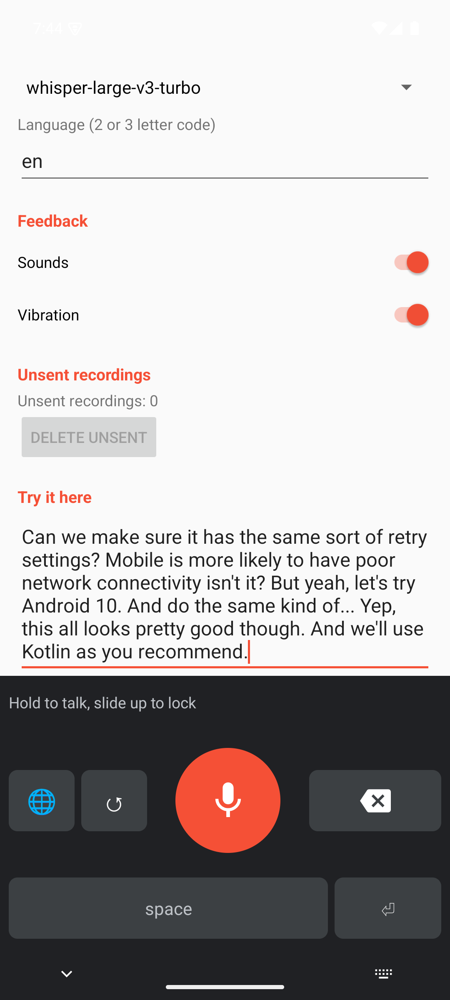

# Groq Voice

An Android keyboard that does one thing: you hold the mic button, talk, let go, and your words get typed
into whatever text box you're in.

The transcription is done by [Groq](https://groq.com/)'s hosted Whisper (`whisper-large-v3-turbo`) using your
own API key. The phone records the audio and sends it straight to Groq. There's no server of mine in the middle.

I built it because Gboard's voice typing kept letting me down, and I already had a desktop voice-typing tool I
liked (a hotkey that records, sends to Groq Whisper and pastes the result). This is the same idea for a phone,
with the same audio format, request settings and retry behaviour.



## What it does

- **Hold to talk.** Press and hold the mic, speak, release. The text appears a moment later.
- **Slide up to lock.** For longer rambles, slide your finger up and let go. It keeps recording until you tap Stop.
- **Slide left to cancel.** Throws the recording away.
- **It copes with bad signal.** Failed uploads retry up to 10 times with backoff, and it waits for the network to
  come back if you've dropped out. If it still can't get through, the recording is kept, and an "unsent" chip lets
  you try again later. You don't lose what you said.
- **It won't type into the wrong chat.** If you've moved to a different text box by the time the text comes back,
  the text goes to the clipboard and the ↺ key instead.
- **The keys you need around it.** Backspace, space, enter (it turns into Send/Go/Search when the app asks for that),
  ↺ to re-insert the last text, and 🌐 to flip back to your normal keyboard.

It isn't a full keyboard. Keep Gboard (or whatever you like) for typing, and switch to this one when you want to talk.

## Requirements

- Android 10 or newer.
- A Groq API key from [console.groq.com](https://console.groq.com/keys).
- Internet access when you send a recording. Nothing is transcribed on the device.

## Install

There's no Play Store listing. Build the APK yourself (see below), then either:

```sh
adb install -r app-release.apk
```

or copy the APK to the phone and open it (you'll need to allow installs from that app).

Then:

1. Open **Groq Voice**, paste your API key, tap **Save** and then **Test key**.
2. Allow the microphone.
3. Tap the button to open the system keyboard settings and turn **Groq Voice** on.
4. In any text box, switch keyboards with the keyboard icon in the navigation bar, or long-press 🌐.

The settings screen also lets you pick the Whisper model and language, turn sounds and vibration on or off, and has a
"Try it here" box for testing.

## Privacy

- Your audio goes to Groq's API over HTTPS and nowhere else. Read [Groq's privacy policy](https://groq.com/privacy-policy/)
  if that matters to you.
- The API key is encrypted with a key held in the Android Keystore. It's never logged or bundled into the APK.
- Recordings stay in the app's private storage. The two most recent successful ones are kept for debugging, along
  with any unsent ones. Backups are turned off, so none of it ends up in a cloud backup.
- Release builds don't write your text to the system log.

## Building

You need JDK 17 or newer (with `javac`) and the Android SDK with platform 36.

```sh
./gradlew assembleDebug          # debug APK in app/build/outputs/apk/debug/
./gradlew testDebugUnitTest      # JVM tests
```

For a signed release build, put these in `~/.gradle/gradle.properties` (not in the repo):

```properties
GROQVOICE_STORE_FILE=/path/to/your-release.jks
GROQVOICE_STORE_PASSWORD=...
GROQVOICE_KEY_ALIAS=...
GROQVOICE_KEY_PASSWORD=...
```

then run `./gradlew assembleRelease`. Keep the keystore safe. Android only accepts updates signed with the same key.

## Tests

Most of the logic (retries, timeouts, the gesture state machine, transcript cleanup, error handling and the
transcription flow) lives in `core/` as plain Kotlin with no Android dependencies, so it's tested on the JVM in a few
seconds. The Groq client is tested against OkHttp's MockWebServer. A thinner layer of instrumented tests runs on an
emulator for the Keystore, the recorder and the keyboard service.

`scripts/verify.sh` runs everything, cheapest first, and stops at the first failure. `scripts/install-hooks.sh`
adds a pre-commit hook that runs the fast layers. The scripts assume my machine's paths in `scripts/env.sh`, so
adjust those for yours.

`CLAUDE.md` has the longer developer notes, including how the release APK was tested on an emulator with real audio
piped into its microphone. The design and implementation plan are in `docs/superpowers/`.

## Not done yet

- An "ask an LLM" mode (the desktop tool has one).
- Text appearing as you talk. Right now it all arrives when you stop.
- Smarter handling of very slow uploads, and dropping the "you" that Whisper sometimes returns for silence.

## Licence

[GNU Affero General Public License v3.0](LICENSE). Copyright (C) 2026 Tim Dobson.

Not affiliated with Groq.
